# TerraMind — Agricultural Intelligence & Decision-Support Platform
### NASA Space Apps Challenge 2026 | Challenge: Field Shift: Adapting Farms with NASA Data

> **"Understand your land. Predict your risks. Make smarter agricultural decisions."**

---

## 1. Executive Summary & Problem Statement

Global climate volatility, increasing drought frequency, seasonal precipitation shifts, and soil degradation pose urgent threats to agricultural food security. Farmers around the world—especially across semiarid plateaus and Mediterranean basins like Turkey—face critical questions:
- *Which crop varieties will remain resilient under shifting rainfall patterns?*
- *When is the optimal planting window to avoid late spring frost and summer heat waves?*
- *What happens if seasonal precipitation drops by 25% or planting is delayed by 3 weeks?*
- *How can crop rotations break soil fungal disease cycles and restore biological nitrogen?*

**TerraMind** directly addresses the NASA Space Apps Challenge 2026 challenge **"Field Shift: Adapting Farms with NASA Data"** by transforming complex satellite observations, global reanalysis climatology, and pedological models into an intuitive, field-level decision-support digital twin.

---

## 2. NASA Earth Observation Data & Scientific Integration

TerraMind integrates documented, authentic Earth observation data sources:

| Data Feed | Source / Sensor | Resolution | Parameters Used | Agricultural Role |
| :--- | :--- | :--- | :--- | :--- |
| **NASA POWER Agroclimatology** | NASA Langley Research Center (MERRA-2 assimilation) | 0.5° &times; 0.5° (~50km) | `T2M`, `T2M_MIN`, `T2M_MAX`, `PRECTOTCORR`, `ALLSKY_SFC_SW_DWN`, `RH2M`, `WS2M` | 30-year monthly temperature extremes, precipitation curves, solar radiation, humidity, frost hazard tracking |
| **ISRIC SoilGrids 2.0** | World Soil Information (ISRIC) | 250m pixels | pH ($H_2O$), Clay %, Sand %, Silt %, SOC (g/kg), CEC, Bulk Density | USDA 12-class textural classification, nutrient retention buffer, subsoil depth stratification (0-5, 5-15, 15-30cm) |
| **MODIS & Sentinel-2 MSI** | NASA Terra/Aqua (MOD13Q1) & ESA Copernicus | 10m - 250m | Band 8 (NIR ~842nm), Band 4 (Red ~665nm) | Multispectral NDVI time series, Vegetation Condition Index (VCI %), canopy greenup phenology |
| **FAO EcoCrop & Drainage Paper 56** | United Nations FAO | Physiological parameters | Base temp ($T_{base}$), optimal temp, seasonal water requirement (mm), salinity/drought limits | Biological suitability envelopes across 11 primary cereal, legume, oilseed, and horticulture crops |

---

## 3. System Architecture

```mermaid
graph TD
    User["Farmer / Agronomist"] --> WebUI["TerraMind Web Application (React 19 + TypeScript + Tailwind CSS)"]
    
    subgraph Frontend_Presentation ["Frontend Presentation Layer"]
        WebUI --> Explorer["Field Explorer & Boundary Map"]
        WebUI --> CropScoring["Multi-Attribute Crop Recommender"]
        WebUI --> SoilIntell["Soil Intelligence & USDA Texture"]
        WebUI --> PlantCalendar["Thermal Planting Window Matrix"]
        WebUI --> SatelliteNDVI["Satellite Remote Sensing NDVI"]
        WebUI --> ClimateRisk["Climate Risk Vulnerability Indices"]
        WebUI --> WhatIfSim["Interactive What-If Simulator"]
        WebUI --> RotationAdv["Botanical Crop Rotation Advisor"]
        WebUI --> AIAdvisor["Context-Aware In-App AI Advisor"]
    end

    subgraph Backend_Engines ["FastAPI Analytical Backend"]
        FastAPI["FastAPI REST Application (Python 3.12)"]
        FastAPI --> NASASvc["NASA POWER Agroclimatology Engine"]
        FastAPI --> SoilSvc["SoilGrids Pedological Engine"]
        FastAPI --> SuitEngine["Multi-Attribute Utility Theory (MAUT)"]
        FastAPI --> CalEngine["Phenological Sowing Window Engine"]
        FastAPI --> RiskEngine["Agro-Climate Vulnerability Index"]
        FastAPI --> SimEngine["What-If Perturbation Stress Model"]
        FastAPI --> RotAdvisor["Crop Succession & Pathogen Break Engine"]
        FastAPI --> AdvisorCore["Natural Language Agricultural Reasoning Engine"]
    end

    subgraph External_Feeds ["Data Sources & Calibration Baselines"]
        NASASvc <--> NASAPowerAPI["NASA POWER REST API"]
        SoilSvc <--> SoilGridsRef["ISRIC SoilGrids 250m Database"]
        SuitEngine <--> FAODB["FAO EcoCrop Agronomic Knowledge Base"]
    end

    WebUI <-->|JSON REST over HTTP| FastAPI
```



---

## 4. Multi-Attribute Crop Recommendation Model

Crop suitability is calculated through a transparent, configurable mathematical scoring model normalized to a 0–100 scale:

$$\text{Suitability Score} = w_T \cdot C_{\text{temp}} + w_W \cdot C_{\text{water}} + w_S \cdot C_{\text{soil}} + w_R \cdot C_{\text{risk}}$$

Where:
- $w_T, w_W, w_S, w_R$: User-configurable component weights (Default: $w_T = 0.30$, $w_W = 0.30$, $w_S = 0.25$, $w_R = 0.15$).
- $C_{\text{temp}}$: Thermal compatibility score based on season mean temperature relative to crop optimal ($T_{opt\_min} - T_{opt\_max}$) and base temperature ($T_{base}$).
- $C_{\text{water}}$: Hydrological satisfaction index based on annual precipitation vs. crop seasonal water requirements (mm), accounting for drought tolerance factors and supplemental irrigation availability.
- $C_{\text{soil}}$: Physical and chemical compatibility score weighting soil pH ($H_2O$) reaction and USDA soil textural triangle constraints.
- $C_{\text{risk}}$: Climate safety index penalizing sub-zero frost exposure during vegetative growth, heat stress exceeding crop flowering thresholds, and drainage compaction risks.

---

## 5. Turkey Demonstration Regions & Benchmark Cases

TerraMind features four pre-configured agricultural demonstration zones representing distinct bioclimatic and pedological environments across Turkey:

1. **Konya Central Anatolian Plateau** (37.87°N, 32.49°E):
   - *Environment:* Semiarid continental plateau (~320 mm annual rainfall, cold snowy winters, hot dry summers).
   - *Soil Profile:* Calcisol / Kastanozem, Alkaline pH 7.8, Clay Loam.
   - *NASA Adaptation Finding:* High drought vulnerability dictates dryland winter cereals (**Barley** #1 at 83/100, **Wheat** #2 at 80/100) or drought-tolerant pulses (**Chickpeas** #3). Corn and rice score poorly (< 45/100) under rainfed conditions due to critical water deficits.

2. **Harran Plain / Şanlıurfa** (37.16°N, 38.80°E):
   - *Environment:* GAP irrigated plain, hot Mediterranean/Syrian steppe transition (~360 mm rain, summer maximums > 41°C).
   - *Soil Profile:* Heavy Chromic Vertisol (52% swelling clay), Alkaline pH 7.9.
   - *NASA Adaptation Finding:* Under irrigation, high growing degree days make **Upland Cotton** and **Maize** highly suitable, provided Verticillium wilt is broken with cereal rotation.

3. **Tekirdağ / Ergene Basin, Thrace** (40.98°N, 27.52°E):
   - *Environment:* Transitional Marmara maritime-continental climate (~580 mm annual rain, temperate winters).
   - *Soil Profile:* Loam / Cambisol, Near-neutral pH 6.7, 2.1% Organic Matter.
   - *NASA Adaptation Finding:* Optimal environment for **Oilseed Sunflower** and **Winter Wheat** rotation.

4. **Çukurova Alluvial Delta / Adana** (36.99°N, 35.33°E):
   - *Environment:* Sub-tropical Mediterranean delta (~670 mm annual rain, mild frost-free winters, long growing season).
   - *Soil Profile:* Deep Fluvisol alluvium, pH 7.4.
   - *NASA Adaptation Finding:* Supports intensive double cropping (**Corn**, **Soybean**, **Processing Tomatoes**, **Cotton**).

---

## 6. What-If Scenario Stress Testing

The interactive **What-If Simulator** allows farmers and policy analysts to test environmental and management perturbations:
- **Rainfall Anomaly:** Adjust expected precipitation from -50% to +50%.
- **Temperature Anomaly:** Model warming from -3°C to +5°C.
- **Sowing Date Shift:** Delay or advance planting from -30 to +45 days.
- **Irrigation Regime:** Compare Rainfed, Deficit Irrigation, and Full Irrigation.

*Example Finding:* In the Konya Basin, delaying winter wheat sowing by 25 days combined with a 20% precipitation reduction causes a 24-point drop in suitability (from 80 to 56/100), as grain filling is pushed directly into June heat waves (> 32°C). Switching to early-maturing **Barley** under deficit irrigation recovers suitability to 79/100.

---

## 7. Installation & Local Execution

### Prerequisites
- Python 3.10+ (Tested on Python 3.12)
- Node.js 18+ (Tested on Node.js v24)
- npm 9+

### 1. Backend Setup
```bash
cd terramind/backend
# Install dependencies (fastapi, uvicorn, numpy, pandas, scipy, pydantic, requests)
pip install fastapi uvicorn numpy pandas scipy pydantic requests

# Start the analytical backend
python -m uvicorn app.main:app --host 0.0.0.0 --port 8000 --reload
```
API Documentation will be accessible at: `http://localhost:8000/docs`

### 2. Frontend Setup
```bash
cd terramind/frontend
# Install npm dependencies
npm install

# Start Vite development server
npm run dev
```
Open `http://localhost:5173` in your browser.

### 3. Running Unit Tests
```bash
cd terramind
python -c "import sys; sys.path.insert(0, 'backend'); import unittest; from tests.test_terramind_core import TestTerraMindCore; suite = unittest.TestLoader().loadTestsFromTestCase(TestTerraMindCore); runner = unittest.TextTestRunner(verbosity=2); result = runner.run(suite); sys.exit(0 if result.wasSuccessful() else 1)"
```

---

## 8. Scientific Limitations & Transparency

1. **Non-Affiliation Notice:** TerraMind is an educational and analytical software prototype developed for the NASA Space Apps Challenge 2026. NASA does not officially endorse or validate TerraMind recommendations.
2. **Laboratory Soil Testing:** Satellite-derived pedological maps (SoilGrids 250m) represent regional spatial models. They cannot replace certified laboratory core testing for field-scale fertilizer prescriptions.
3. **Weather Forecasts vs. Climatology:** Climatological averages indicate multi-year probabilities; farmers must always consult local 5-day weather forecasts before sowing.

---

*TerraMind &bull; NASA Space Apps Challenge 2026 &bull; Field Shift: Adapting Farms with NASA Data*

